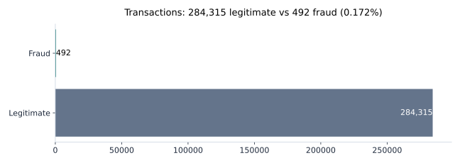
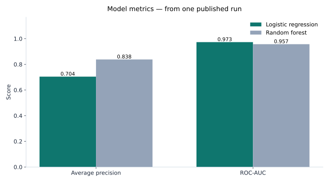

# Credit Card Fraud Pattern Analysis

I am Lovely Kumari. I worked as a Data Analyst at JEEVIKA in Bihar, India
for 3 years. Now I have an M.S. in Information Systems from Rider
University, and I live in Jersey City, NJ.

I built this project because the problem is simple to say and hard to solve.
Only 492 out of 284,807 transactions were fraud. That is the whole problem.
How do you find those 492 without flagging thousands of good transactions?

## The data

The dataset is public, from Kaggle:
[Credit Card Fraud Detection](https://www.kaggle.com/datasets/mlg-ulb/creditcardfraud).
It was collected by Worldline and the Machine Learning Group of
Universite Libre de Bruxelles (ULB).

- **284,807 transactions** from European cardholders in **September 2013**,
  over just two days.
- **492 were fraud (0.172%)**. **284,315 were legitimate.** About
  **1 in 579** transactions is fraud.
- **31 columns:** `Time`, `V1` to `V28`, `Amount`, `Class`
  (1 = fraud, 0 = legitimate).
- `V1` to `V28` are anonymised with PCA. The real features are not shared.
  So I worked with amounts, timing, and those anonymised columns only.

The dataset is **not** in this repo. See
[`data/DATA_SOURCE.md`](data/DATA_SOURCE.md) for where to get it.

## How to run it

1. Download `creditcard.csv` into `data/` (see `data/DATA_SOURCE.md`).
2. `pip install -r requirements.txt`
3. Open `notebooks/01-fraud-pattern-analysis.ipynb` and run it top to bottom.
4. The SQL queries in `sql/fraud_queries.sql` run on the same CSV loaded
   into a table called `creditcard_fraud`.

## What I found

**The imbalance is extreme.** Fraud is 492 out of 284,807. If you ignore
that, your model will look good on paper and fail in real life.

**Accuracy is a trap here.** If you guess "not fraud" every time, you get
99.83% right. And you catch nothing. Zero fraud. So I did not judge models
on accuracy. I used precision, recall, F1, and AUPRC. The Kaggle page
suggests AUPRC too.

**A simple baseline does a decent job.** In one published run of this
dataset, logistic regression got an average precision of **0.704** and
ROC-AUC of **0.973**. A random forest got average precision **0.838**
and ROC-AUC **0.957**. My notebook builds the logistic regression baseline
with `class_weight='balanced'`. It reports precision, recall, F1, and
AUPRC. Not accuracy alone.

**What the numbers mean for a fraud team:** recall is how much real fraud
you catch. Precision is how many of the ones you flag are really fraud.
If you push recall up, you get more false alarms. Each false alarm costs a
real analyst time. AUPRC sums up that trade-off in one number.

**The notebook also checks amounts and timing.** It compares the `Amount`
spread for fraud vs legitimate transactions, and the fraud rate by amount
band and by hour of day. All of it is computed from the data.

## What this is not

- The data covers **only two days in September 2013**. It cannot show how
  fraud looks today, or how it changes over time.
- `V1` to `V28` are anonymised. This says nothing about what a real
  fraudster does. It only shows patterns in anonymised numbers.
- This is not a production fraud system. A real one needs live data, more
  features, and a cost model for false alarms vs missed fraud.

## Files

- `notebooks/01-fraud-pattern-analysis.ipynb` — the full analysis
- `sql/fraud_queries.sql` — the same questions in SQL
- `requirements.txt` — Python packages
- `data/DATA_SOURCE.md` — where the dataset comes from
